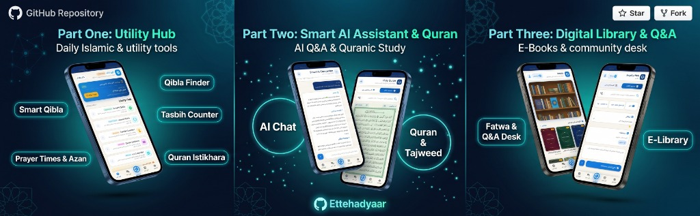

<div align="center">

# ☪️ Islam Unity / اتحاد اسلامی

**An Open-Source Islamic Knowledge & AI Platform**

**پلتفرم اوپن سورس معارف اسلامی و هوش مصنوعی**

[English](#english) · [فارسی](#فارسی) · [Contributing](CONTRIBUTING.md) · [Roadmap](ROADMAP.md)


</div>

<div align="center">
  
</div>

---

<a id="english"></a>

## 🌍 English

### About

**Islam Unity (اتحاد اسلامی)** is a comprehensive, open-source Islamic platform that combines traditional Islamic knowledge — including the Holy Quran, Hadith, Tafsir, and Fiqh — with modern AI technology. Our mission is to make authentic Islamic scholarship accessible to everyone, everywhere, through intelligent tools and a beautiful user experience.

### 🕊️ Our Vision: Unity Across All Islamic Schools of Thought (تقریب و همگرایی مذاهب)

> **"This platform is the culmination of two years of dedicated labor. Our foundational mission is to provide an inclusive sanctuary where adherents, scholars, and researchers of all Islamic schools of thought — Ja'fari, Hanafi, Shafi'i, Maliki, Hanbali, Zaydi, and beyond — collaborate side by side in mutual brotherhood and respect. Together, we strive to elevate Islamic scholarship, expand access to authentic knowledge, and strengthen the bonds of unity across the Muslim Ummah without polarization or discord."**

### ⚡ Built for Developers: Ready-to-Use Islamic Backend & REST API

> **Why reinvent the wheel?** Developers building Islamic mobile apps, websites, or research tools no longer need to spend months architecting database schemas, parsing Arabic/Persian classical texts, or building complex search infrastructure. **Islam Unity provides a complete, production-ready, asynchronous FastAPI backend with 46+ RESTful endpoints** covering the Holy Quran, Hadith databases, digital library, prayer times, Qibla calculation, and state-of-the-art AI assistants. You can clone this engine and immediately power your own applications!

Whether you're a student of knowledge, a scholar, or simply curious, Islam Unity provides the resources and AI-powered assistance you need to deepen your understanding of Islam.

### ✨ Features

| Feature | Description |
|---------|-------------|
| 📖 **Quran** | Complete 114 Surahs with Ayahs, Tadabbur (reflection), multiple reciters, and smart search |
| 📚 **Digital Library** | Books, chapters, knowledge chunks, and RAG-powered semantic search across Islamic texts |
| 🤖 **AI Chat** | Multi-provider LLM integration (DeepSeek, NVIDIA, and more) for Islamic Q&A and research |
| 🕌 **Consultation** | Scholar messaging system with urgent threads and priority routing |
| 📱 **Mobile App** | Native Flutter app for iOS & Android with offline-first architecture |
| 🛡️ **Admin Dashboard** | RTL-native Persian SPA covering 8 management domains (users, content, AI, analytics, etc.) |
| 📊 **Analytics** | Usage tracking, AI token monitoring, cost analysis, and system health dashboards |
| 🤲 **Dhikr & Prayer** | Daily dhikr counter, prayer times, and spiritual tracking tools |
| 📰 **Knowledge Feed** | Curated Islamic Q&A feed with AI-generated and scholar-verified answers |

### 🛠️ Tech Stack

| Layer | Technologies |
|-------|-------------|
| **Backend** | Python 3.11+, FastAPI, SQLAlchemy 2.0, aiosqlite, asyncpg, Pydantic v2 |
| **Admin Dashboard** | Vanilla JS (ES2022), CSS Custom Properties, RTL-first design |
| **Mobile** | Flutter 3.x / Dart, shared_preferences, flutter_markdown |
| **AI / ML** | DeepSeek, NVIDIA NIM, multi-provider LLM architecture, Qdrant vector DB |
| **Infrastructure** | Docker, Docker Compose, uvicorn, WebSockets, SSE |
| **Auth** | JWT (PyJWT), bcrypt, SMS OTP (MeliPayamak) |

### 🚀 Quick Start

#### Prerequisites

- Python 3.11+
- Flutter 3.x SDK
- Git

#### 1. Clone the repository

```bash
git clone https://github.com/YOUR_USERNAME/islam-unity.git
cd islam-unity
```

#### 2. Backend Setup

```bash
cd backend

# Create and activate virtual environment
python -m venv venv
# Windows
venv\Scripts\activate
# macOS / Linux
source venv/bin/activate

# Install dependencies
pip install -r requirements.txt

# Copy and configure environment variables
cp .env.example .env
# Edit .env with your configuration (API keys, database URL, etc.)

# Run the server
uvicorn app.main:app --reload --host 0.0.0.0 --port 8000
```

#### 3. Flutter App Setup

```bash
cd flutter_app

# Get dependencies
flutter pub get

# Run on a connected device or emulator
flutter run
```

#### 4. Access the Admin Dashboard

Open your browser and navigate to:

```
http://localhost:8000/admin/
```

### 📁 Project Structure

```
unity_V2/
├── backend/                    # FastAPI backend
│   ├── app/
│   │   ├── api/v1/            # REST API endpoints
│   │   ├── admin/static/      # Admin dashboard (HTML/JS/CSS)
│   │   ├── core/              # Security, middleware, exceptions
│   │   ├── db/                # Database models & sessions
│   │   ├── schemas/           # Pydantic request/response schemas
│   │   ├── services/          # Business logic & AI services
│   │   ├── config.py          # App configuration
│   │   └── main.py            # FastAPI application entry point
│   ├── tests/                 # Backend test suite
│   ├── requirements.txt
│   └── Dockerfile
├── flutter_app/               # Flutter mobile application
│   ├── lib/                   # Dart source code
│   ├── assets/                # App assets (images, fonts)
│   ├── android/               # Android platform config
│   └── pubspec.yaml
├── raw_data_books/            # Source Islamic texts
│   ├── fiqh/                  # Fiqh (jurisprudence) books
│   ├── hadith/                # Hadith collections
│   ├── tafsir/                # Quran commentaries
│   └── misc/                  # Other Islamic literature
├── knowledge_backup/          # Processed knowledge base backups
├── docs/                      # Additional documentation
├── ettehad-logo-kit/          # Brand assets & logo kit
├── docker-compose.yml
├── CONTRIBUTING.md
├── ROADMAP.md
└── README.md
```

### 🔗 API Overview

The Islam Unity backend exposes **46+ RESTful API endpoints** organized across the following domains:

| Domain | Endpoints | Description |
|--------|-----------|-------------|
| **Auth** | `/api/v1/auth/*` | Registration, login, SMS OTP, JWT tokens |
| **Quran** | `/api/v1/quran/*` | Surahs, Ayahs, search, tadabbur, reciters |
| **Library** | `/api/v1/library/*` | Books, chapters, chunks, RAG search |
| **AI Chat** | `/api/v1/ai/*` | Chat sessions, streaming responses, token tracking |
| **Consultation** | `/api/v1/consultation/*` | Scholar messaging, thread management |
| **Feed** | `/api/v1/feed/*` | Knowledge Q&A feed |
| **Dhikr** | `/api/v1/dhikr/*` | Dhikr tracking and daily stats |
| **Prayer** | `/api/v1/prayer/*` | Prayer times by location |
| **Developer** | `/api/v1/developer/*` | API keys, usage stats, documentation |
| **Admin** | `/api/v1/admin/*` | Full admin CRUD operations |
| **WebSocket** | `/ws/*` | Real-time AI chat streaming |

> 📝 **Interactive API docs** are available at `http://localhost:8000/docs` (Swagger UI) and `http://localhost:8000/redoc` (ReDoc) when the server is running.

### 📸 Screenshots

<div align="center">

> _Screenshots coming soon — contributions welcome!_
>
> If you'd like to contribute screenshots of the app, admin dashboard, or API docs, please see our [Contributing Guide](CONTRIBUTING.md).

</div>

### 🤝 Contributing

We warmly welcome contributions from developers, designers, Islamic scholars, and translators! Please read our [Contributing Guide](CONTRIBUTING.md) to get started.

### 📄 License

This project is licensed under the **GNU General Public License v3.0** — see the [LICENSE](LICENSE) file for details.

### 💬 Contact

- **GitHub Issues**: [Report a Bug or Request a Feature](https://github.com/YOUR_USERNAME/unity_V2/issues)
- **Discussions**: [Join the Conversation](https://github.com/YOUR_USERNAME/unity_V2/discussions)

---

<a id="فارسی"></a>

<div dir="rtl">

## 🌙 فارسی

### درباره پروژه

**اتحاد اسلامی (Islam Unity)** یک پلتفرم جامع و اوپن سورس اسلامی است که معارف سنتی اسلامی — شامل قرآن کریم، احادیث، تفاسیر و فقه — را با فناوری نوین هوش مصنوعی ترکیب می‌کند. مأموریت ما دسترسی‌پذیر کردن معارف اصیل اسلامی برای همگان در سراسر جهان، با ابزارهای هوشمند و تجربه کاربری زیبا است.

چه طالب علم باشید، چه محقق و چه صرفاً کنجکاو، اتحاد اسلامی منابع و دستیار هوش مصنوعی لازم برای تعمیق فهم شما از اسلام را فراهم می‌کند.

### ✨ ویژگی‌ها

| ویژگی | توضیحات |
|-------|---------|
| 📖 **قرآن کریم** | ۱۱۴ سوره کامل با آیات، تدبر، قاریان متعدد و جستجوی هوشمند |
| 📚 **کتابخانه دیجیتال** | کتب، فصول، قطعات دانشی و جستجوی معنایی RAG در متون اسلامی |
| 🤖 **چت هوش مصنوعی** | یکپارچگی با LLM‌های چندگانه (DeepSeek، NVIDIA و غیره) برای پرسش و پاسخ اسلامی |
| 🕌 **مشاوره** | سیستم پیام‌رسانی با علما، رشته‌های فوری و اولویت‌بندی |
| 📱 **اپلیکیشن موبایل** | اپلیکیشن Flutter برای iOS و اندروید با معماری آفلاین‌فرست |
| 🛡️ **پنل مدیریت** | پنل تک‌صفحه‌ای فارسی RTL با ۸ حوزه مدیریتی |
| 📊 **تحلیل و آمار** | ردیابی استفاده، نظارت بر توکن‌های AI، تحلیل هزینه و سلامت سیستم |
| 🤲 **ذکر و نماز** | شمارنده ذکر روزانه، اوقات شرعی و ابزارهای معنوی |
| 📰 **فید دانش** | فید پرسش و پاسخ اسلامی با پاسخ‌های تولید شده توسط AI و تأیید شده توسط علما |

### 🛠️ فناوری‌ها

| لایه | فناوری‌ها |
|------|----------|
| **بک‌اند** | Python 3.11+, FastAPI, SQLAlchemy 2.0, aiosqlite, asyncpg, Pydantic v2 |
| **پنل مدیریت** | Vanilla JS (ES2022)، CSS Custom Properties، طراحی RTL |
| **موبایل** | Flutter 3.x / Dart |
| **هوش مصنوعی** | DeepSeek, NVIDIA NIM, معماری چند ارائه‌دهنده LLM, Qdrant |
| **زیرساخت** | Docker, Docker Compose, uvicorn, WebSockets, SSE |
| **احراز هویت** | JWT (PyJWT), bcrypt, OTP پیامکی (ملی پیامک) |

### 🚀 شروع سریع

#### پیش‌نیازها

- Python 3.11+
- Flutter 3.x SDK
- Git

#### ۱. کلون کردن مخزن

</div>

```bash
git clone https://github.com/YOUR_USERNAME/islam-unity.git
cd islam-unity
```

<div dir="rtl">

#### ۲. راه‌اندازی بک‌اند

</div>

```bash
cd backend
python -m venv venv
venv\Scripts\activate          # ویندوز
# source venv/bin/activate    # مک / لینوکس
pip install -r requirements.txt
cp .env.example .env
# فایل .env را ویرایش کنید
uvicorn app.main:app --reload --host 0.0.0.0 --port 8000
```

<div dir="rtl">

#### ۳. راه‌اندازی اپلیکیشن Flutter

</div>

```bash
cd flutter_app
flutter pub get
flutter run
```

<div dir="rtl">

#### ۴. دسترسی به پنل مدیریت

مرورگر خود را باز کنید و به آدرس زیر بروید:

</div>

```
http://localhost:8000/admin/
```

<div dir="rtl">

### 🤝 مشارکت

ما از مشارکت توسعه‌دهندگان، طراحان، علمای اسلامی و مترجمان استقبال می‌کنیم! لطفاً [راهنمای مشارکت](CONTRIBUTING.md) را مطالعه کنید.

### 📄 مجوز

این پروژه تحت مجوز **GNU General Public License v3.0** منتشر شده است.

### 💬 ارتباط با ما

- **مشکلات و پیشنهادات**: [ثبت مشکل یا درخواست ویژگی](https://github.com/YOUR_USERNAME/unity_V2/issues)
- **بحث و گفتگو**: [شرکت در گفتگوها](https://github.com/YOUR_USERNAME/unity_V2/discussions)

</div>
